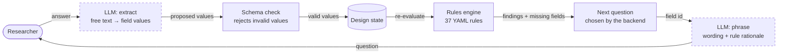
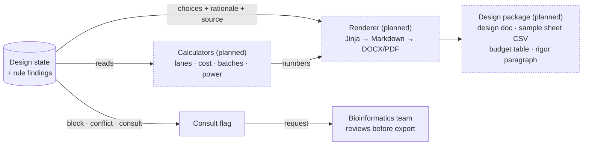

# How a design moves through PlanOmics

<!-- GENERATED by tools/build_workflow.py from knowledge/*.yaml. Do not edit by hand; re-run the script. -->

A researcher answers questions one step at a time. Each answer updates the design state, the rulebook re-evaluates it, and the backend chooses what to ask next. The LLM only handles wording.

**37** rules · **28** golden scenarios · **3** block · **10** strong · **9** suggest · **15** info · **2** request a consult

## One turn of the interview

Dashed boxes are the only places the LLM is involved: it turns free text into proposed field values and phrases a question the backend already picked. Every recommendation and number comes from the rules engine or a calculator. Power users can edit the design card directly, which skips the extract step.

## What happens at Review

The document is rendered from the design state and never written by the LLM. A design goes to the team if any rule blocks it, two equally strong rules disagree, or a rule asks for a consult. Blocking rules also stop export until the issue is resolved. Dotted boxes are not built yet.

## Severity levels

| Level | Meaning |
|---|---|
| `info` | Context for the researcher; nothing to change. |
| `suggest` | A recommended default; easy to override. |
| `strong` | Strongly recommended for this design; override only with a reason. |
| `block` | Export is blocked until resolved or a consult is requested. |
| `consult` | Routes the design to the Bioinformatics team without blocking. |

## Rules at each step

Each rule is listed at the first step where all of its trigger fields are known. What it recommends may land in a later step: depth rules triggered by the question fill in Sequencing.

[Question](#1-question) (4) → [Samples](#2-samples) (19) → [Library](#3-library) (6) → [Design](#4-design) (7) → [Batches](#5-batches) (1) → [Sequencing](#6-sequencing) (0) → [Budget](#7-budget) (0) → [Review](#8-review) (0)

### 1. Question

_What is the biological question? Gene-level DE, isoforms, lncRNA; is global transcription expected to shift?_

| Rule | Severity | Source | When | Recommends | Asks for |
|---|---|---|---|---|---|
| `rnaseq.depth.isoform` | **strong** | team | question.goal ∈ {isoform, splicing, fusion} | `sequencing.target_reads_per_sample` → 60M `sequencing.paired_end` → yes | — |
| `rnaseq.lncrna.library` | **strong** | team | question.goal = lncRNA | `library.prep` → rRNA_depletion `library.stranded` → yes `sequencing.target_reads_per_sample` → 50M | — |
| `rnaseq.spikein.global_change` | **strong** | team | question.expected_global_transcription_change = yes | `library.spike_in` → ERCC_per_cell_number | `sample.cell_counts_available` |
| `rnaseq.spikein.not_needed` | **info** | team | question.expected_global_transcription_change = no · question.goal = gene_level_de | `library.spike_in` → none | — |

Why does this matter? (rationales)

- **`rnaseq.depth.isoform`**: Isoform/splicing/fusion analyses need paired-end reads and greater depth than gene-level DE.
- **`rnaseq.lncrna.library`**: Many lncRNAs are not polyadenylated, are often antisense to coding genes, and are expressed at low levels. Use rRNA depletion (keeps non-polyadenylated RNA), a stranded library (resolves antisense transcripts) and deeper sequencing (~50M reads).
- **`rnaseq.spikein.global_change`**: Standard normalization assumes most genes are unchanged. If the perturbation may shift total transcription (e.g. degrons of global regulators, transcription inhibitors), add spike-ins proportional to cell number, not to RNA mass.
- **`rnaseq.spikein.not_needed`**: Spike-ins are not required for standard differential expression.

### 2. Samples

_Organism, sample source, preservation, RNA quality (RIN, DV200), input amount, sex._

| Rule | Severity | Source | When | Recommends | Asks for |
|---|---|---|---|---|---|
| `rnaseq.low_input` | **strong** | team | sample.input_ng < 10 | `library.prep` → low_input_full_length `library.umi` → yes | — |
| `rnaseq.pdx.host_reads` | **strong** | team | sample.source = pdx | `analysis.host_read_removal` → yes | — |
| `rnaseq.prep.degraded` | **strong** | team | sample.preservation = ffpe | `library.prep` → rRNA_depletion | `sample.dv200` |
| `rnaseq.prep.whole_blood_globin` | **strong** | team | sample.source = whole_blood | `library.globin_depletion` → yes | `sample.collection_tube` |
| `rnaseq.quality.dv200_low` | **strong** + consult | team | sample.dv200 < 30 | `library.prep` → rRNA_depletion | — |
| `core.sabv.both_sexes` | **suggest** | team | sample.sex = both | `design.sex_balanced` → yes | `design.sex_balanced` |
| `rnaseq.blood.edta_tube` | **suggest** | team | sample.source = whole_blood · sample.collection_tube = edta | — | — |
| `rnaseq.prep.intact_standard` | **suggest** | team | sample.preservation ∈ {fresh_frozen, fresh} · question.goal = gene_level_de · sample.rin ≥ 7 | `library.prep` → polyA | — |
| `rnaseq.quality.low_rin` | **suggest** | team | sample.preservation ∈ {fresh_frozen, fresh} · sample.rin < 7 | `library.prep` → rRNA_depletion | `sample.dv200` |
| `core.animal.replicate_definition` | **info** | team | sample.source ∈ {animal_tissue, pdx} | — | — |
| `core.cell_line.replicate_definition` | **info** | team | sample.source = cell_line | — | `sample.passage_range` `sample.str_authenticated` `sample.mycoplasma_tested` |
| `core.human_subjects` | **info** | team | sample.organism = human · sample.source ∈ {patient_tissue, whole_blood, pbmc} | — | `project.irb_status` |
| `core.organism.other` | **info** + consult | team | sample.organism = other | — | — |
| `core.organoid.replicate_definition` | **info** | team | sample.source = organoid | — | — |
| `core.sabv.ask` | **info** | literature | sample.organism ∈ {human, mouse, rat} | — | `sample.sex` |
| `core.sabv.single_sex` | **info** | literature | sample.organism ∈ {mouse, rat} · sample.sex ∈ {male, female} | — | — |
| `core.sorted_cells.replicate_definition` | **info** | team | sample.source = sorted_cells | — | `sample.input_ng` |
| `rnaseq.prep.pbmc` | **info** | team | sample.source = pbmc | `library.globin_depletion` → no | — |
| `rnaseq.quality.dv200_moderate` | **info** | team | sample.dv200 ≥ 30 · sample.dv200 < 50 | `library.prep` → rRNA_depletion | — |

Why does this matter? (rationales)

- **`rnaseq.low_input`**: Very low input libraries have high duplication; use a low-input chemistry and UMIs.
- **`rnaseq.pdx.host_reads`**: PDX tissue contains mouse stroma; plan computational removal of mouse reads (e.g. combined reference).
- **`rnaseq.prep.degraded`**: FFPE RNA is fragmented; poly(A) capture loses 5' coverage. Use rRNA depletion and assess quality by DV200 rather than RIN.
- **`rnaseq.prep.whole_blood_globin`**: Globin transcripts can consume a large share of reads in whole blood, reducing effective depth for other genes.
- **`rnaseq.quality.dv200_low`**: DV200 below 30% means most RNA fragments are shorter than 200 nt. Library yield and complexity are likely to be poor and many samples may fail. Discuss with the Bioinformatics team before committing samples (re-extraction, more input, or excluding samples). Threshold adopted by the team from library-kit vendor guidance; not an ENCODE standard.
- **`core.sabv.both_sexes`**: Balance sex across conditions so sex is not confounded with treatment, and include sex as a covariate in the model. Testing sex differences themselves needs a larger design.
- **`rnaseq.blood.edta_tube`**: EDTA tubes do not stabilize RNA; transcript profiles change within hours at room temperature. Prefer RNA-stabilizing tubes (PAXgene, Tempus). If EDTA is unavoidable, standardize and record time-to-processing for every sample.
- **`rnaseq.prep.intact_standard`**: Intact RNA and a gene-level question: poly(A) selection is the standard, cost-effective choice.
- **`rnaseq.quality.low_rin`**: RIN below 7 indicates partial degradation. Poly(A) capture then biases coverage toward the 3' end; rRNA depletion is more robust to degradation. Also measure DV200, which is more informative than RIN for degraded RNA.
- **`core.animal.replicate_definition`**: For animal studies, a biological replicate is an individual animal. Animals in one cage share environment, so spread conditions across cages and litters, and record cage and litter for the batch layout.
- **`core.cell_line.replicate_definition`**: For cell lines, biological replicates are independent cultures (separate passages or thaws, processed on different days), not wells split from one flask.
- **`core.human_subjects`**: Human subject material: confirm IRB status. Do not enter PHI in this tool.
- **`core.organism.other`**: Organisms without a well-annotated reference genome need a consult: alignment, annotation and possibly de novo transcript assembly must be planned before sequencing.
- **`core.organoid.replicate_definition`**: For organoids, independent lines from different donors are the strongest replicates. If only one line is used, replicates are independent passages cultured and treated separately, and conclusions apply to that line only.
- **`core.sabv.ask`**: NIH expects sex to be considered as a biological variable in vertebrate animal and human studies (NOT-OD-15-102), and reviewers assess it under Rigor. Record the sex of subjects, animals or cell lines; it is also a useful QC check (XIST / Y-chromosome genes).
- **`core.sabv.single_sex`**: Single-sex animal studies need a stated justification in NIH applications (NOT-OD-15-102), e.g. a sex-specific disease model. Note the justification in the design document.
- **`core.sorted_cells.replicate_definition`**: For sorted cells, a biological replicate is an independent sort from a separate animal or donor, not a split of one sort. Record sorting purity and the number of cells per sample, which determines RNA input and library chemistry.
- **`rnaseq.prep.pbmc`**: PBMCs generally do not need globin depletion; note any RBC contamination during isolation.
- **`rnaseq.quality.dv200_moderate`**: DV200 of 30-50% indicates moderately degraded RNA. rRNA depletion is appropriate; expect lower library complexity than intact RNA. Threshold adopted by the team from library-kit vendor guidance; not an ENCODE standard.

### 3. Library

_Library prep, strandedness, globin depletion, spike-ins, UMIs._

| Rule | Severity | Source | When | Recommends | Asks for |
|---|---|---|---|---|---|
| `rnaseq.prep.three_prime_tag_incompatible` | **block** | team | library.prep = three_prime_tag · question.goal ∈ {isoform, splicing, fusion, lncRNA} | — | — |
| `rnaseq.depth.gene_level` | **suggest** | encode | question.goal = gene_level_de · library.prep ∈ {polyA, rRNA_depletion} | `sequencing.target_reads_per_sample` → 30M | — |
| `rnaseq.depth.three_prime_tag` | **suggest** | team | library.prep = three_prime_tag | `sequencing.target_reads_per_sample` → 10M `sequencing.paired_end` → no | — |
| `rnaseq.library.unstranded` | **suggest** | team | library.stranded = no | `library.stranded` → yes | — |
| `rnaseq.spikein.ercc_fraction` | **suggest** | encode | library.spike_in ∈ {ERCC, ERCC_per_cell_number} | `library.spike_in_target_fraction` → 0.02 | — |
| `rnaseq.library.stranded_default` | **info** | team | library.stranded not given | `library.stranded` → yes | — |

Why does this matter? (rationales)

- **`rnaseq.prep.three_prime_tag_incompatible`**: 3' tag libraries sequence only the 3' end of polyadenylated transcripts. They cannot resolve isoforms, splice junctions or fusions, and miss non-polyadenylated lncRNAs. Use a full-length library (poly(A) or rRNA depletion) for this question.
- **`rnaseq.depth.gene_level`**: ENCODE4 targets 30M aligned reads per replicate for bulk RNA-seq (20M in older projects). For DE, additional replicates add more power than depth beyond ~20-30M.
- **`rnaseq.depth.three_prime_tag`**: 3' tag libraries yield one read per transcript end, so gene-level counts saturate at lower depth than full-length libraries; about 10M reads per sample, single-end, is sufficient. Not an ENCODE standard (ENCODE does not cover 3' tag RNA-seq).
- **`rnaseq.library.unstranded`**: An unstranded library cannot assign reads to the correct strand where genes overlap on opposite strands, which mis-assigns counts for a few percent of genes and rules out antisense analysis. Use unstranded only to match an existing unstranded dataset.
- **`rnaseq.spikein.ercc_fraction`**: ENCODE uses ERCC (Ambion) Mix 1 at about 2% of mapped reads. Too little gives noisy spike-in estimates; too much wastes sequencing depth on spike-ins.
- **`rnaseq.library.stranded_default`**: Stranded libraries record which DNA strand each transcript came from. This resolves overlapping and antisense genes and is required to quantify antisense/lncRNA transcription. Stranded kits are now the default at most cores at little or no extra cost.

### 4. Design

_Factors and groups, replicates per group, pairing, perturbation and controls._

| Rule | Severity | Source | When | Recommends | Asks for |
|---|---|---|---|---|---|
| `core.replicates.none` | **block** | team | design.biological_replicates_per_group < 2 | `design.biological_replicates_per_group` → 3 | — |
| `core.replicates.minimum` | **strong** | team | design.biological_replicates_per_group < 3 | `design.biological_replicates_per_group` → 3 | — |
| `rnaseq.knockdown.control` | **strong** | encode | design.perturbation_type ∈ {shRNA, siRNA, CRISPR_KO, CRISPRi} | `design.matched_nontargeting_control` → yes | — |
| `core.design.paired_model` | **suggest** | team | design.paired = yes | — | `design.pairing_factor` |
| `core.design.pairing_question` | **info** | team | sample.source ∈ {patient_tissue, whole_blood, pbmc, pdx} · design.paired not given | — | `design.paired` |
| `rnaseq.knockdown.depth_floor` | **info** | encode | design.perturbation_type ∈ {shRNA, siRNA, CRISPR_KO, CRISPRi} | — | — |
| `rnaseq.prep.three_prime_tag_option` | **info** | team | question.goal = gene_level_de · design.n_samples ≥ 96 · library.prep not given | — | — |

Why does this matter? (rationales)

- **`core.replicates.none`**: With one sample per group, biological variance cannot be estimated, so no statistical test of differential expression is valid and results cannot be called reproducible. This applies even to pilot studies.
- **`core.replicates.minimum`**: Differential testing needs at least 3 biological replicates per group to estimate biological variance. ENCODE's minimum of 2 targets reproducibility of reference data, not statistical power.
- **`rnaseq.knockdown.control`**: ENCODE requires a matched control experiment for knockdown/CRISPR RNA-seq; include non-targeting controls.
- **`core.design.paired_model`**: Paired design: include the pairing unit (patient, donor, litter) as a blocking term in the model, e.g. ~ patient + condition, and keep both samples of a pair in the same processing batch where possible. Losing one sample of a pair weakens the paired comparison.
- **`core.design.pairing_question`**: Samples from the same patient, donor or PDX line (e.g. pre/post treatment, tumor/normal) are paired. Pairing removes between-individual variation from the comparison and changes both the analysis model and the power estimate, so it must be known up front.
- **`rnaseq.knockdown.depth_floor`**: ENCODE's floor for knockdown/CRISPR RNA-seq is 10M aligned reads per replicate. That is a QC minimum for detecting the targeted knockdown, not a target for genome-wide DE; the gene-level depth recommendation (30M) still applies.
- **`rnaseq.prep.three_prime_tag_option`**: With 96 or more samples and a gene-level question, a 3' tag-counting library is a cost-effective option: lower per-sample library cost and roughly 5-10M reads per sample. Trade-offs: no isoform information, and 3' bias makes it less suitable for degraded RNA from some sources. Discuss with the Bioinformatics team if budget is the constraint.

### 5. Batches

_How samples are split across processing batches; condition must never be confounded with batch._

- **Planned:** Seeded, balanced batch-layout generator

| Rule | Severity | Source | When | Recommends | Asks for |
|---|---|---|---|---|---|
| `core.batch.confounded` | **block** | team | design.batch_confounded_with_condition = yes | — | — |

Why does this matter? (rationales)

- **`core.batch.confounded`**: Condition is fully confounded with processing batch; the effect of treatment cannot be separated from batch. Re-balance so each batch contains every condition.

### 6. Sequencing

_Depth, read layout and length. Receives depth recommendations from earlier steps._

- **Planned:** Reads → lanes / flow cells calculator

No rules trigger at this step yet.

### 7. Budget

_Cost and timeline from the facility table._

- **Planned:** Cost calculator (facility table)
- **Planned:** Power / replicate estimate

No rules trigger at this step yet.

### 8. Review

_Design document, exports, and the consult request to the Bioinformatics team._

- **Planned:** Renderer: design doc, sample sheet CSV, budget table, rigor paragraph

No rules trigger at this step yet.

---

Generated from: knowledge/common/core_rules.yaml v0.1.0 · knowledge/rnaseq/rules.yaml v0.1.0. Rules marked `encode` follow ENCODE4 QC floors; all other thresholds are team drafts pending review.
